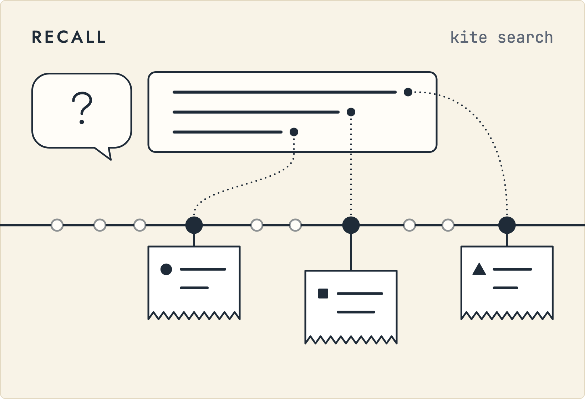
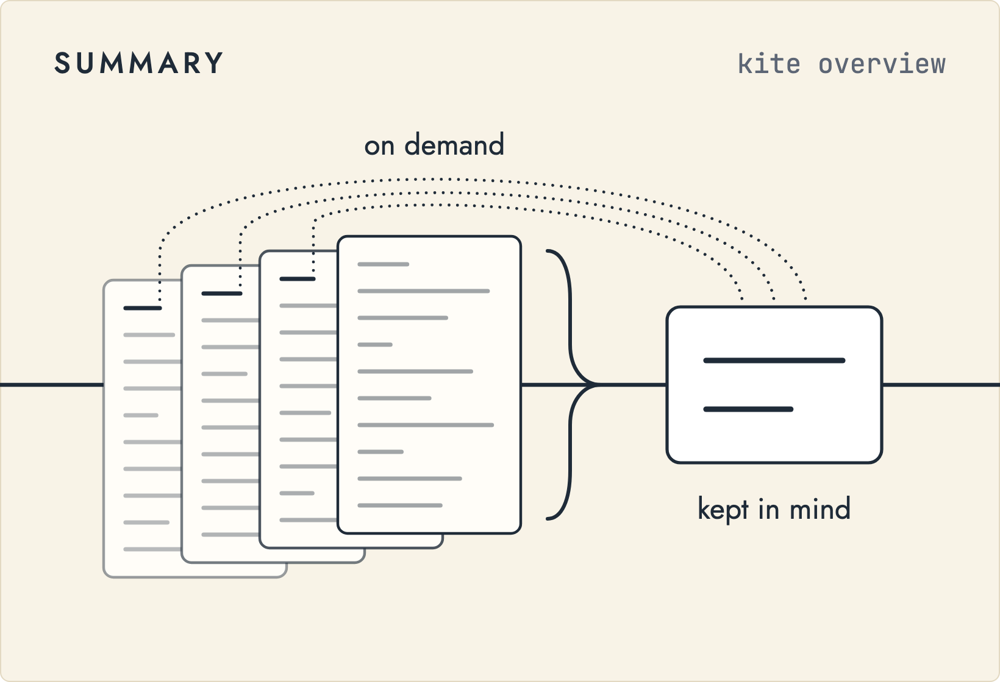
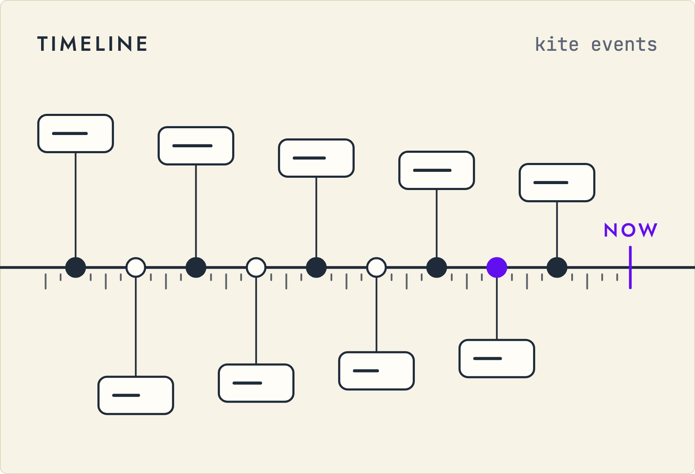
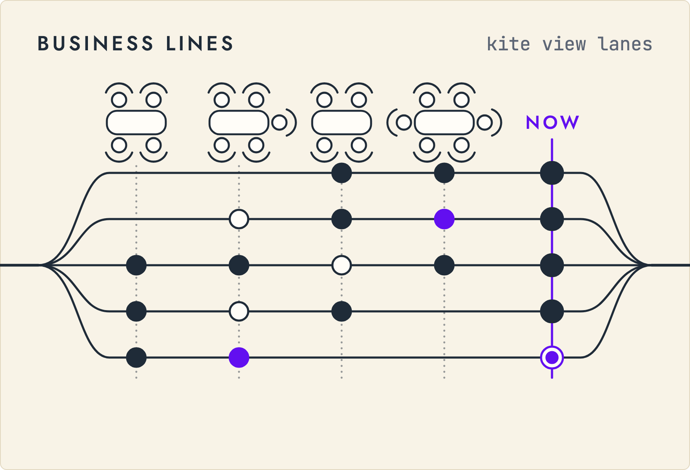
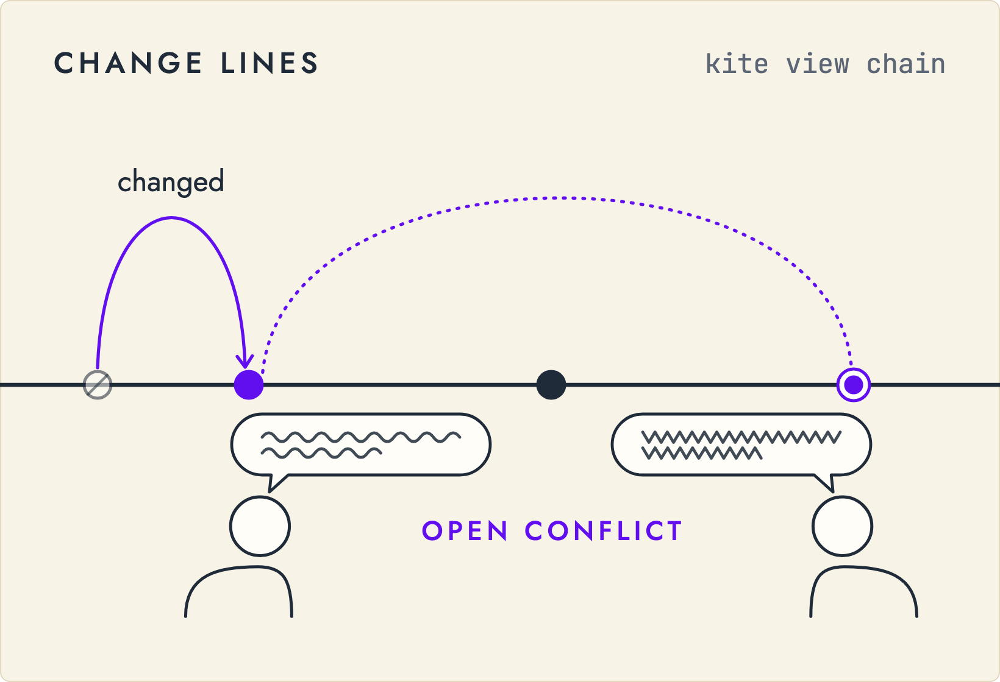
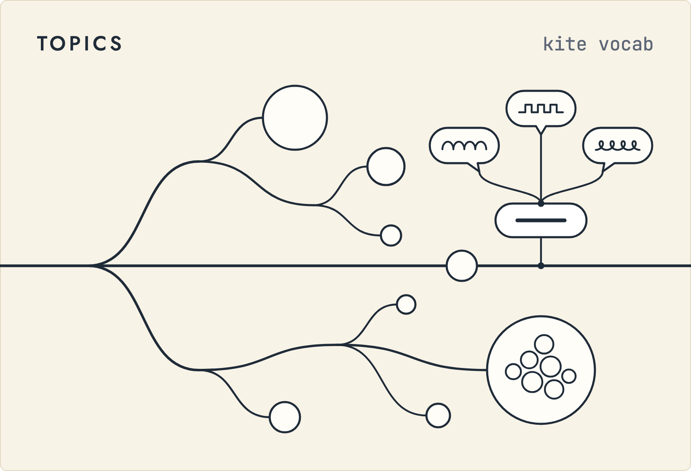

<div align="center">

<a href="https://memoket.ai/"></a>

### Follow the thread, not the nearest match.

Open-source and vector-free, KITE is **conversation memory infrastructure** that sits between your agent and your meetings: your agent does the reasoning, and KITE keeps every fact on **a line back to what was said**.

<a href="https://memoket.ai/"></a>
<a href="https://discord.com/invite/tFh4nur4Vn"></a>
<a href="https://x.com/Memoket_AI"></a>
<a href="https://www.instagram.com/memoket_ai/"></a>
<a href="https://www.facebook.com/833979799808573/"></a>

</div>

<br>

<p align="center">
  
</p>

<a id="news"></a>

## 📢 News

- **[2026-11-02]**: 📄 Our paper **[KITE: Retrieval as a Decision Procedure for Long-Term Conversational Memory](https://arxiv.org/abs/2610.41521)** is now on arXiv.
- **[2026-10-26]**: 🎬 Released an **[explainer video](#video)** of how KITE works, from a message to a cited answer.
- **[2026-08-13]**: 🎉 First public release: **[KITE v0.1.0](https://github.com/memoket/memoket-kite/releases/tag/v0.1.0)** is open source under Apache-2.0 and on **[PyPI](https://pypi.org/project/memoket-kite/)** as `memoket-kite`.

<a id="views"></a>

## 🪁 The Views

One memory, laid out the way each question needs. Your meetings go in once, and your agent
reads the same thread back in whichever view the question calls for.

<p align="center">
  
  
</p>
<p align="center">
  
  
</p>
<p align="center">
  
  
</p>

Each picture shows the shape of what the command in its corner returns. `kite view lanes`
and `kite view chain` also render business lines and change lines as pages you can open;
try them on the demo memory in the [Quick Start](#quick-start).

## 💡 Why KITE by Memoket

Most AI memory turns every sentence into a cloud of numbers and hands back whatever
lands closest to your question. It always returns *something*, even when the answer
was never there, and it cannot show you *why*.

KITE by Memoket follows what a question means, not how it sounds.

> **"Who's the decision-maker on the Henderson account now?"**
>
> Nothing in memory says *decision-maker*:
>
> - *March.* Marcus: "I'll sign off on Henderson."
> - *June.* The new VP of Ops: "Dana owns Henderson from here."
>
> Both were filed under the same topic when they were written. Then *now* sorts them
> by date. Similarity has no notion of *now*: nearest-match memory rates March just as
> relevant and answers **"Marcus"**, with nothing to tell you it is wrong. With KITE the
> answer is **"Dana"**, with the June line attached.

|  | Nearest-match memory | 🪁 KITE by Memoket |
|---|---|---|
| **Finds** | whatever *sounds* like the question | the facts that *answer* it |
| **When it was never said** | returns something anyway | comes back empty, and says so |
| **Why this answer?** | a similarity score | a readable plan, with who said it and when |
| **Runtime stack** | embeddings · vector DB · rerankers | one portable, topic-indexed memory |
| **Ask again tomorrow** | depends on the index that day | the same plan walks the same steps |

KITE keeps the memory; your agent does the thinking.


<a id="how-it-works"></a>

## ⚙️ How It Works

The whole idea in one line: **conversations settle into facts under topics, and a
question finds its topic and pulls that topic's memories, receipts included.**

<a id="video"></a>

https://github.com/user-attachments/assets/a5c053fb-36de-4eeb-8d2d-d652792314f4

#### 1 · Message → Fact

A user says, **"I moved to Tokyo on July 26."** Your agent works out what happened and
writes it back with `kite write`. KITE checks the source line, files the fact under its
topics, and keeps the original message as evidence:

```xml
<fact t="2026-07-26" kind="event" who="user"
      place="tokyo" event="move" src="chat1L1">
  The user moved to Tokyo on 26 July 2026.
</fact>
<line id="chat1L1" who="user">I moved to Tokyo on July 26.</line>
```

#### 2 · Question → Plan

When someone asks **"Where does the user live now?"**, your agent turns the question
into a plan you can read, validate, and cache:

```json
{
  "select": "facts",
  "where": {"who": ["user"], "event": ["move"]},
  "pipe": [
    {"op": "sort", "key": "t", "desc": true},
    {"op": "head", "n": 1}
  ]
}
```

#### 3 · Plan → Execution

The executor runs the plan over the topic index. Keywords and associations come
first, then conditions filter down to the one moment that answers the question:

```text
SEARCH facts
FILTER who = "user" AND event = "move"
SORT BY event_time DESC
TAKE 1
```

The same validated plan always follows the same steps over the same memory, with no
embeddings, no vector database, and no model call anywhere.

#### 4 · Evidence → Answer

Your agent answers from that evidence, and the receipt travels with it:

```text
Answer: Tokyo
Source: chat1L1, "I moved to Tokyo on July 26."
```

### Key Features

<table>
<tr>
<td width="33%" valign="top"><h4 align="center">🚫 No vector stack</h4>
No embeddings, no vector database, and no model calls in the agent tools. Your agent does the reasoning.</td>
<td width="33%" valign="top"><h4 align="center">🗂️ Structured facts</h4>
Conversations settle into six layers you can open and read: Lines, Atoms, Entities, Events, Series, and Topics.</td>
<td width="33%" valign="top"><h4 align="center">🔍 Inspectable queries</h4>
Every question can become a symbolic plan, revealing exactly how each answer was matched.</td>
</tr>
<tr>
<td valign="top"><h4 align="center">🕐 Time-aware retrieval</h4>
People, events, dates, and updates handled directly, so <em>"now"</em> means now.</td>
<td valign="top"><h4 align="center">🧾 Shows its work</h4>
Evidence links straight back to the moment it came from: who said it, when, and the actual words.</td>
<td valign="top"><h4 align="center">🤷 Knows what it doesn't know</h4>
When something was never said, the search comes back genuinely empty, and KITE says so.</td>
</tr>
</table>


<a id="quick-start"></a>

## 🚀 Quick Start

### 1. Install

```bash
git clone https://github.com/memoket/memoket-kite.git && cd memoket-kite
python -m pip install -e ".[mcp]"
```

No API key to set: the `kite` tools make no model calls. Your agent brings its own model.

### 2. Remember

Replay the demo: four public product meetings from the
[AMI Meeting Corpus](https://groups.inf.ed.ac.uk/ami/corpus/) (CC BY 4.0), ingested as
Lines, with the facts, events, and threads an agent wrote back about them:

```bash
bash examples/agent_demo/run.sh
export KITE_MEMORY=artifacts/ami-demo/meetings.xml
```

For your own conversations, start a memory with `kite init my-meetings.xml` and point
`KITE_MEMORY` at it; `kite ingest` then takes a whisper.cpp, SRT, VTT, or plain-text
transcript, and `kite write` takes what your agent extracted from it.

### 3. Recall

Search what was said, pull facts by topic, or follow a thread, each carrying its sources,
then lay every thread out across the meetings:

```bash
kite search "kinetic" --layer lines
kite atoms --topic power_source
kite events --series S3 --expand
kite view lanes --out lanes.html
```

The same topic lookup from Python:

```python
from memoket_kite.tools import MemoryTools

memory = MemoryTools.open("artifacts/ami-demo/meetings.xml")
for atom in memory.atoms(topic="power_source")["atoms"]:
    print(atom["text"], [line["id"] for line in atom["src"]])
```

### 4. Answer

Hand the memory to your agent. It follows the KITE skills, answers with the original
lines attached, and writes back what it learns:

```bash
kite setup claude        # or: kite setup codex
claude
```

> What did the team decide about the power source, and when did it change?

Full reference in [docs/agent-tools.md](https://github.com/memoket/memoket-kite/blob/main/docs/agent-tools.md);
the demo, step by step, in
[`examples/agent_demo/`](https://github.com/memoket/memoket-kite/blob/main/examples/agent_demo/README.md).


<a id="benchmarks"></a>

## 📊 Benchmark Results

KITE's memory representation is evaluated on LoCoMo and LongMemEval-S, two public
long-conversation memory benchmarks; the method and its results are in
[our paper](https://arxiv.org/abs/2610.41521). Each benchmark runs under a written
protocol, with `gpt-4.1-mini` used across all benchmark stages, from building the memory
to reading and judging; the exact rubrics are in the
[LoCoMo protocol](https://github.com/memoket/memoket-kite/blob/main/benchmarks/locomo/protocol.py)
and
[LongMemEval protocol](https://github.com/memoket/memoket-kite/blob/main/benchmarks/longmemeval/protocol.py).

<details>
<summary><b>How a local run is recorded</b></summary>
<br>

Every rebuilt run writes a local manifest naming the exact commit, corpus
digest, tokenizer, and plan-cache digest it used. Judging records the answers,
verdicts, and score in a second manifest keyed to the first. A completed run can
validate that seal and recompute its metrics offline; the reference verifier
also checks the manifest-declared paths, counts, and reported aggregate. Details
are in the
[benchmark guide](https://github.com/memoket/memoket-kite/blob/main/benchmarks/README.md)
and
[reproducibility notes](https://github.com/memoket/memoket-kite/blob/main/docs/reproducibility.md);
the benchmark corpora keep their own licences, spelled out in
[`LICENSE-DATA.md`](https://github.com/memoket/memoket-kite/blob/main/LICENSE-DATA.md).

</details>


## 🔗 Integrations

KITE by Memoket plugs into the agent you already use: Claude Code, Codex, Muse, Grok Bot,
or any agent with a terminal. `kite setup claude` or
`kite setup codex` installs the skill pack: one router and five workflows your agent
follows, to ingest a recording, extract and write back, recall with receipts, lay out
business lines, and trace what changed. The same read and write tools also run as a
local [MCP server](https://github.com/memoket/memoket-kite/blob/main/docs/agent-tools.md#mcp-tools)
over stdio, with no model calls:

```bash
python -m pip install "memoket-kite[mcp]"
kite mcp --memory ./artifacts/ami-demo/meetings.xml
```

Use an existing writable KITE XML file, such as the demo memory from the Quick Start.
Recordings are transcribed on your own machine with
[whisper.cpp](https://github.com/ggml-org/whisper.cpp). Prefer KITE to run extraction
and answering with a model you configure? The [Memory API](docs/api.md) and `kite-mcp`
do that; see the [Claude Code example](docs/mcp.md). Normal library installation
remains dependency-free.

Want yours first? [Tell us on Discord](https://discord.com/invite/tFh4nur4Vn).

<p align="center">
  
</p>

<p align="center">
  <a href="https://apps.apple.com/us/app/memoket/id6758686146"></a>
  &nbsp;&nbsp;
  <a href="https://play.google.com/store/apps/details?id=com.ssheng.memoket"></a>
</p>

## ✨ Experience KITE with Memoket

**The memory you just read about ships today.** KITE is the algorithm inside
every Memoket: the same topic-filed facts, the same line back to the source,
running on your own device. Ask it *"didn't this client say their fiscal year ends
in March?"* months later, and it surfaces the exact moment: who said it, when, and
in their words.

Memoket captures memories; KITE is the memory itself.

https://github.com/user-attachments/assets/685ac90d-95ab-4114-a7d3-c22ec3db94a0

<p align="center">
  <a href="https://memoket.ai/pages/use-cases"><strong>See more of Memoket in action →</strong></a>
</p>

## 🤝 Community

- 💬 [Discord](https://discord.com/invite/tFh4nur4Vn) for questions, ideas, and integration requests
- 🐛 [Issues](https://github.com/memoket/memoket-kite/issues) for bugs and feature requests
- 🔧 [Contributing guide](https://github.com/memoket/memoket-kite/blob/main/CONTRIBUTING.md) · 🔒 [Security policy](https://github.com/memoket/memoket-kite/blob/main/SECURITY.md)

## 📖 Citation

If KITE helps your work, please cite our paper,
[KITE: Retrieval as a Decision Procedure for Long-Term Conversational Memory](https://arxiv.org/abs/2610.41521).

## 📄 License

KITE by Memoket is released under the
[Apache License 2.0](https://github.com/memoket/memoket-kite/blob/main/LICENSE).

<br>

<p align="center">
  <em>Like its name, KITE by Memoket stays light enough to fly, always on a line back to the truth.</em> 🪁
</p>
